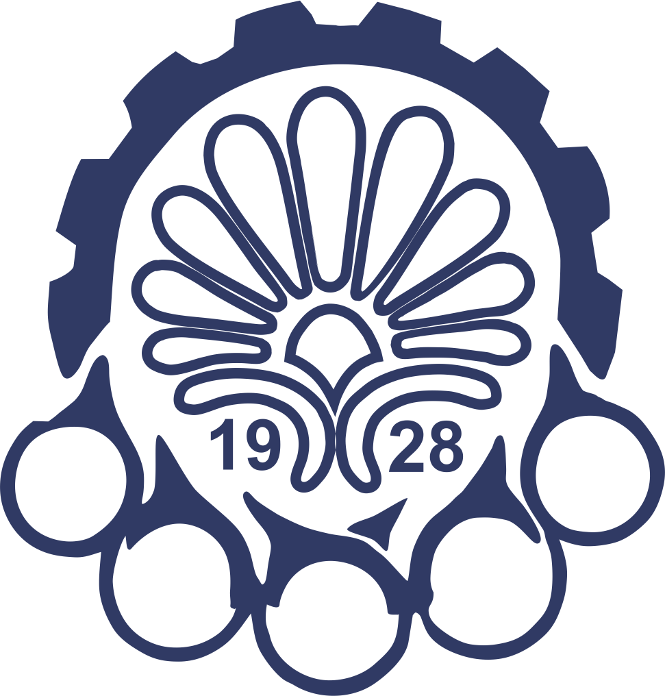

## Teaching Experience

::: {.ta-entry}

  
  

::: {.ta-content}
### Numerical Linear Algebra
**Teaching Assistant** | Instructor: Prof. Mehdi Dehghan | *Jan. 2024 – Feb. 2026*

- Proposed project concepts.
- Designed theoretical and practical Python exercises.
- Edited and proofread official course lecture notes.
- Administered oral examinations and evaluated student performance.
:::
:::

::: {.ta-entry}

  
  

::: {.ta-content}
### Advanced Programming
**Teaching Assistant** | Instructor: Prof. Mehdi Ghatee | *Jan. 2024 – July 2024*

- Authored lecture notes on [File I/O](/teaching/course-materials/java-file-io/index.qmd) and [Classes in Java](/teaching/course-materials/java-classes/index.qmd).
- Delivered weekly lab lectures.
- Designed practical projects, including [RSS Reader](/teaching/course-materials/rss-reader/index.qmd) and Image Viewer.
- Administered oral examinations and evaluated student performance.
:::
:::

::: {.ta-entry}

  
  

::: {.ta-content}
### Artificial Intelligence
**Teaching Assistant** | Instructor: Prof. Mehdi Ghatee | *Sept. 2023 – Feb. 2024*

- Selected as 1 of 10 teaching assistants from a pool of 34 applicants.
- Designed project guidelines aligned with course syllabus requirements.
- Organized a final review session and delivered a guest lecture on probabilistic reasoning.
- Supported students with homework assignments.
:::
:::

::: {.ta-entry}

  
  

::: {.ta-content}
### Principles of Operating Systems
**Teaching Assistant** | Instructor: Dr. Mohammad Mahdi Bejani | *Feb. 2023 – July 2023*

- Proposed practical course project concepts.
- Evaluated student performance through one-on-one oral assessments.
:::
:::

## Course Materials

::: {#course-materials}
:::